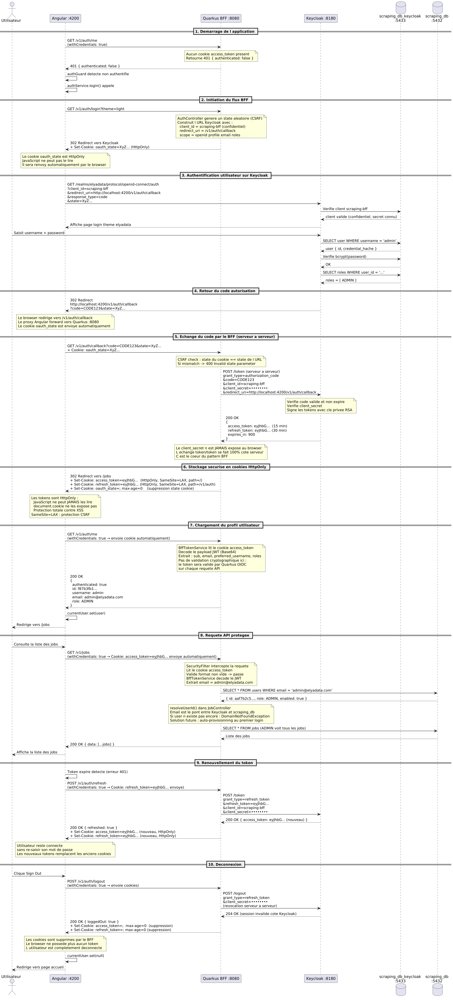

# BFF Authentication Guide

Backend For Frontend Pattern with Keycloak — AI-Assisted Configurable Web Scraping Platform

---

## 1. Overview

This document describes the Backend For Frontend (BFF) authentication pattern used in the platform. The BFF pattern moves all OAuth2/OIDC logic to the backend, ensuring that access tokens never reach the browser JavaScript.

### 1.1 Why BFF?

In a traditional SPA OAuth2 flow, the frontend receives tokens directly from the identity provider and stores them in localStorage or non-HttpOnly cookies. This exposes tokens to XSS attacks.

The BFF pattern solves this by keeping tokens exclusively on the server side, stored in HttpOnly cookies that JavaScript cannot read.

### 1.2 Before vs After

| Aspect | Before (PKCE Public) | After (BFF Confidential) |
|--------|---------------------|--------------------------|
| Token location | Browser JS (cookie/localStorage) | HttpOnly cookie (invisible to JS) |
| OAuth2 flow | Frontend talks to Keycloak directly | Backend talks to Keycloak |
| Client type | Public client | Confidential client with secret |
| Auth header | Authorization: Bearer xxx | Cookie sent automatically |
| Frontend library | angular-oauth2-oidc | None (window.location redirect) |
| XSS risk | Token accessible via JS | Token inaccessible to JS |

---

## 2. Architecture

### 2.1 Authentication Flow




### 2.2 Component Responsibilities

| Component | Layer | Responsibility |
|-----------|-------|----------------|
| AuthController.java | Backend | Login, register, callback, me, refresh, logout endpoints. Exchanges codes for tokens. Sets HttpOnly cookies. |
| SecurityFilter.java | Backend | JAX-RS filter that checks for access_token cookie or Authorization header. Rejects unauthenticated requests with 401. |
| BffTokenService.java | Backend | Reads and decodes the JWT from the HttpOnly cookie. Provides getSubject(), getEmail(), getUsername(), hasRole() for controllers. |
| auth.service.ts | Frontend | Redirects to backend for login/register/logout. Calls /v1/auth/me to get user info. Never touches tokens. |
| auth.interceptor.ts | Frontend | Adds withCredentials: true to all API requests so browser sends cookies automatically. |
| proxy.conf.json | Frontend | Proxies /v1/* from Angular dev server (4200) to backend (8080) so cookies work on same origin. |

---

## 3. Keycloak Configuration

### 3.1 Realm Setup

The platform uses a Keycloak realm named `elyadata` with three realm roles: ADMIN, OPERATOR, and READER. The realm is auto-imported from `realm-export.json` when the Docker container starts for the first time.

### 3.2 BFF Client Configuration

A confidential client named `scraping-bff` is configured with these settings:

| Setting | Value |
|---------|-------|
| Client ID | scraping-bff |
| Client Authentication | ON (confidential client) |
| Standard Flow | Enabled (Authorization Code flow) |
| Direct Access Grants | Disabled |
| Valid Redirect URIs | http://localhost:4200/v1/auth/callback |
| Web Origins | http://localhost:8080, http://localhost:4200 |
| PKCE | Not required (confidential client uses secret) |

The client secret is stored in the backend `application.yml` as `bff.client.secret` and must match the secret in Keycloak.

### 3.3 Realm Roles

| Role | Description |
|------|-------------|
| ADMIN | Full access: manage users, view all jobs, configure platform |
| OPERATOR | Create, launch, and manage own scraping jobs |
| READER | View-only access to jobs and extracted data |

Roles are included in the JWT access token via a protocol mapper (`realm-roles-mapper`) under the claim `realm_access.roles`. The `BffTokenService` reads this claim to determine the user's role.

### 3.4 Realm Import and Export

The realm is defined in `keycloak/realm-export.json` and auto-imported on first start via the Keycloak `--import-realm` flag. The import strategy is `IGNORE_EXISTING`, meaning it only imports if the realm does not already exist.

To force a re-import (for example after changing the realm-export.json):

```bash
docker compose down -v
docker compose up -d
```

The `-v` flag removes the PostgreSQL volume used by Keycloak, forcing a clean import.

### 3.5 Custom Login Theme

Keycloak uses a custom theme located in `keycloak/themes/elyadata/login/`. The theme supports dark and light modes, synchronized with the Angular frontend via a `theme` query parameter passed during login.

---

## 4. Backend Configuration

### 4.1 application.yml Key Settings

**BFF section** contains Keycloak base URL, client ID, client secret, callback URI, and frontend URL:

```yaml
bff:
  keycloak:
    base-url: http://localhost:8180/realms/elyadata/protocol/openid-connect
  client:
    id: scraping-bff
    secret: ${BFF_CLIENT_SECRET:bff-dev-secret-change-in-prod}
  callback-uri: http://localhost:4200/v1/auth/callback
  frontend-url: http://localhost:4200
```

**Quarkus OIDC** is configured with `proactive: false` so it does not automatically reject requests without a Bearer token. This is critical because the SecurityFilter and BffTokenService handle authentication at the JAX-RS level by reading the HttpOnly cookie directly.

**HTTP Permissions** are all set to `permit` at the Quarkus level. Authentication enforcement is delegated entirely to the SecurityFilter.

**CORS** has `access-control-allow-credentials: true` so the browser includes cookies in cross-origin requests.

### 4.2 Why proactive: false?

By default, Quarkus OIDC operates in proactive mode: it intercepts every incoming request at the Vert.x layer (before JAX-RS filters run) and rejects any request without a valid Bearer token in the Authorization header.

Since BFF authentication uses HttpOnly cookies (not Authorization headers), Quarkus OIDC would reject all browser requests. Setting `proactive: false` tells Quarkus to only verify tokens when explicitly required, allowing the SecurityFilter to handle cookie-based auth.

In this architecture, `@RolesAllowed` annotations are not used on controllers. Instead, controllers inject `BffTokenService` and call `hasRole()` manually.

### 4.3 API Endpoints

| Method | Path | Description |
|--------|------|-------------|
| GET | /v1/auth/login | Redirects to Keycloak login page |
| GET | /v1/auth/register | Redirects to Keycloak registration page |
| GET | /v1/auth/callback | Exchanges code for tokens, sets HttpOnly cookies, redirects to frontend |
| GET | /v1/auth/me | Returns current user info from cookie (id, username, email, role) |
| POST | /v1/auth/refresh | Rotates access and refresh token cookies |
| POST | /v1/auth/logout | Revokes token at Keycloak, clears cookies |

---

## 5. Frontend Configuration

### 5.1 Proxy Setup (Development)

In development, Angular runs on `localhost:4200` and the backend on `localhost:8080`. Since cookies are domain-scoped, a proxy is required so all requests go through the same origin.

**proxy.conf.json** (at the root of the frontend project):

```json
{
  "/v1": {
    "target": "http://localhost:8080",
    "secure": false,
    "changeOrigin": true
  }
}
```

**angular.json** (under serve > options):

```json
"options": {
  "proxyConfig": "proxy.conf.json"
}
```

**environment.ts**:

```typescript
export const environment = {
  production: false,
  apiUrl: '',  // empty string, requests go through the proxy
};
```

With this setup, Angular calls `/v1/auth/me` on `localhost:4200`, the proxy forwards it to `localhost:8080`, and cookies are on the same origin.

### 5.2 Auth Service

The `auth.service.ts` replaces the previous `angular-oauth2-oidc` integration. Key methods:

- `login()`: Redirects to the backend `/v1/auth/login` via `window.location.href`.
- `register()`: Redirects to the backend `/v1/auth/register`.
- `initialize()`: Calls `GET /v1/auth/me` to check authentication status. Called by `APP_INITIALIZER` on app startup.
- `logout()`: Calls `POST /v1/auth/logout`, then navigates to the landing page.
- `refresh()`: Calls `POST /v1/auth/refresh` to rotate cookies.
- `getAccessToken()`: Always returns null. The token is in an HttpOnly cookie and cannot be read by JavaScript.

### 5.3 Auth Interceptor

The `auth.interceptor.ts` adds `withCredentials: true` to all API requests. This tells the browser to include HttpOnly cookies with every request. No Authorization header is set.

### 5.4 Auth Guard

The `auth.guard.ts` waits for `initialize()` to complete before checking `isAuthenticated()`. If the user is not authenticated, it calls `login()` to redirect to Keycloak.

### 5.5 Removed Dependencies

The following are no longer needed and should be removed:

- `angular-oauth2-oidc` (run `npm uninstall angular-oauth2-oidc`)
- `provideOAuthClient()` from `app.config.ts`
- `OAuthStorage` provider from `app.config.ts`

---

## 6. Cookie Security

### 6.1 Cookie Properties

| Cookie | HttpOnly | SameSite | Secure | Path |
|--------|----------|----------|--------|------|
| access_token | Yes | LAX | false (dev) | / |
| refresh_token | Yes | LAX | false (dev) | /v1/auth |
| oauth_state | Yes | LAX | false (dev) | /v1/auth/callback |

### 6.2 Security Properties Explained

- **HttpOnly: true** prevents JavaScript from reading the cookie via `document.cookie`, mitigating XSS attacks.
- **SameSite: LAX** allows cookies to be sent on top-level navigations (redirects from Keycloak) but blocks them on cross-site sub-requests.
- **Secure**: In production, set to `true` to ensure cookies are only sent over HTTPS.
- **Path scoping**: The refresh_token cookie is scoped to `/v1/auth` so it is only sent to auth endpoints, reducing exposure.

### 6.3 CSRF Protection

The login flow includes CSRF protection via a state parameter. Before redirecting to Keycloak, the backend generates a random state value and stores it in an HttpOnly cookie (`oauth_state`). When Keycloak redirects back, the backend verifies that the state in the query parameter matches the state in the cookie. A mismatch indicates a potential CSRF attack and the request is rejected.

---

## 7. User Synchronization

Users must exist in both Keycloak (for authentication) and the application database `scraping_db` (for authorization and data ownership). The email field is used as the link between the two systems.

### 7.1 Adding Users Manually

1. Open the Keycloak admin console at http://localhost:8180/admin.
2. Select the `elyadata` realm.
3. Navigate to **Users** and click **Add user**.
4. Fill in username, email, first name, last name, then click **Create**.
5. Go to the **Credentials** tab, click **Set password**, enter the password, disable **Temporary**, and click **Save**.
6. Go to the **Role mapping** tab, click **Assign role**, and select ADMIN, OPERATOR, or READER.

The email in Keycloak must match the email in the `users` table of `scraping_db`.

### 7.2 Sync Script

A shell script `sync-users-to-keycloak.sh` is provided to bulk-synchronize users from the application database to Keycloak:

```bash
chmod +x sync-users-to-keycloak.sh
./sync-users-to-keycloak.sh

# With a custom default password
DEFAULT_PASSWORD=MyPassword123 ./sync-users-to-keycloak.sh
```

---

## 8. Development Setup

### 8.1 Prerequisites

- Docker and Docker Compose
- Java 21+ and Maven
- Node.js 20+ and Angular CLI

### 8.2 Start Infrastructure

```bash
docker compose up -d
```

This starts PostgreSQL, Keycloak, and MailHog. On first start, the `elyadata` realm is imported automatically.

### 8.3 Start Backend

```bash
mvn quarkus:dev
```

The backend starts on http://localhost:8080. BFF authentication endpoints are available at `/v1/auth/*`.

### 8.4 Start Frontend

```bash
cd Frontend && ng serve
```

The frontend starts on http://localhost:4200 with the proxy forwarding `/v1/*` to the backend.

### 8.5 Test the Login Flow

1. Open http://localhost:4200 in the browser.
2. Click **Login**.
3. You are redirected to the Keycloak login page.
4. Enter credentials (e.g., admin@elyadata.com / admin123).
5. After successful login, you are redirected back to the jobs page.
6. The navbar displays the username and role from the JWT cookie.

### 8.6 Troubleshooting

**Realm 'elyadata' already exists. Import skipped:** Run `docker compose down -v && docker compose up -d` to force a clean import.

**invalid_client_credentials:** The client secret in `application.yml` does not match Keycloak. Check the Credentials tab in the Keycloak admin console for the `scraping-bff` client.

**PKCE enforced Client without code challenge method:** Remove the `pkce.code.challenge.method` attribute from the client configuration. Confidential clients do not need PKCE.

**/v1/auth/me returns authenticated: false:** Ensure the proxy is configured correctly and that the callback URI in Keycloak matches `http://localhost:4200/v1/auth/callback`.

**Bearer access token is not available in logs:** This is expected with `proactive: false`. Authentication is handled by the SecurityFilter and BffTokenService, not by Quarkus OIDC.

---

## 9. Production Deployment Notes

- Set `Secure: true` on all cookies (requires HTTPS).
- Use a real client secret (not `bff-dev-secret-change-in-prod`).
- Set `quarkus.oidc.tls.verification: required`.
- Configure a proper CORS origin (not localhost).
- Use `SameSite: Strict` if frontend and backend share the same domain.
- Set `bff.callback-uri` and `bff.frontend-url` to production URLs.
- Configure Keycloak `redirectUris` and `webOrigins` for the production domain.

---

## 10. File Reference

| File | Purpose |
|------|---------|
| AuthController.java | BFF auth endpoints (login, callback, me, refresh, logout) |
| BffTokenService.java | Decodes JWT from HttpOnly cookie for controllers |
| SecurityFilter.java | JAX-RS filter enforcing cookie-based authentication |
| CorsConfig.java | CORS with allow-credentials for cookie support |
| application.yml | BFF config, OIDC config, proactive: false |
| realm-export.json | Keycloak realm with scraping-bff client |
| auth.service.ts | Angular auth service (redirects, /me, logout) |
| auth.interceptor.ts | Adds withCredentials: true to API calls |
| auth.guard.ts | Waits for init, checks auth, redirects to login |
| proxy.conf.json | Dev proxy: /v1/* from 4200 to 8080 |
| sync-users-to-keycloak.sh | Syncs DB users to Keycloak |
